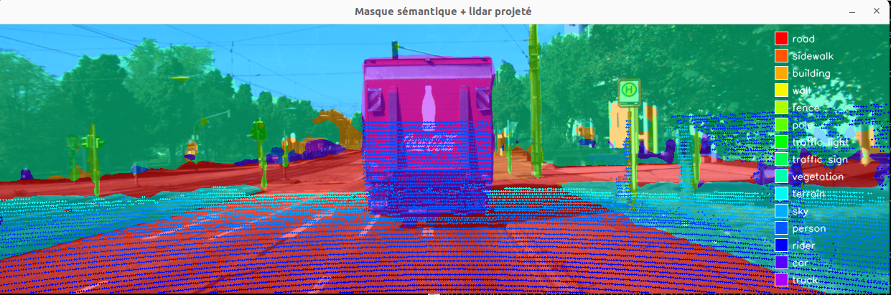
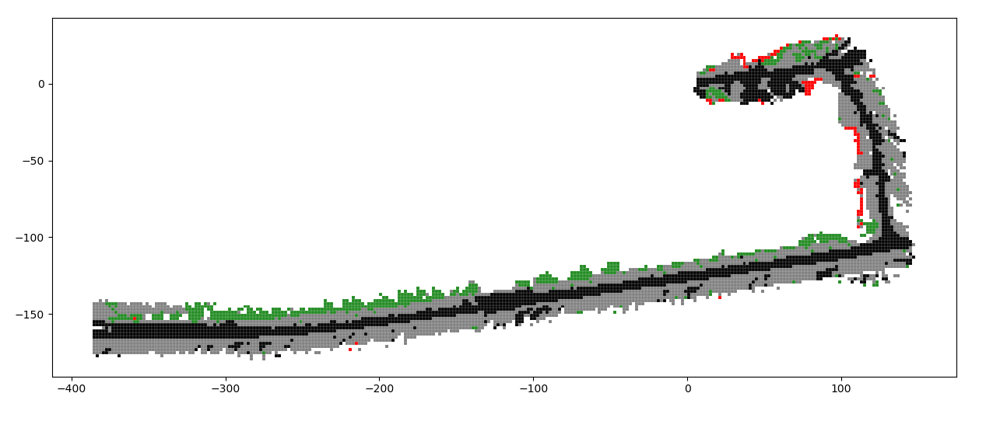
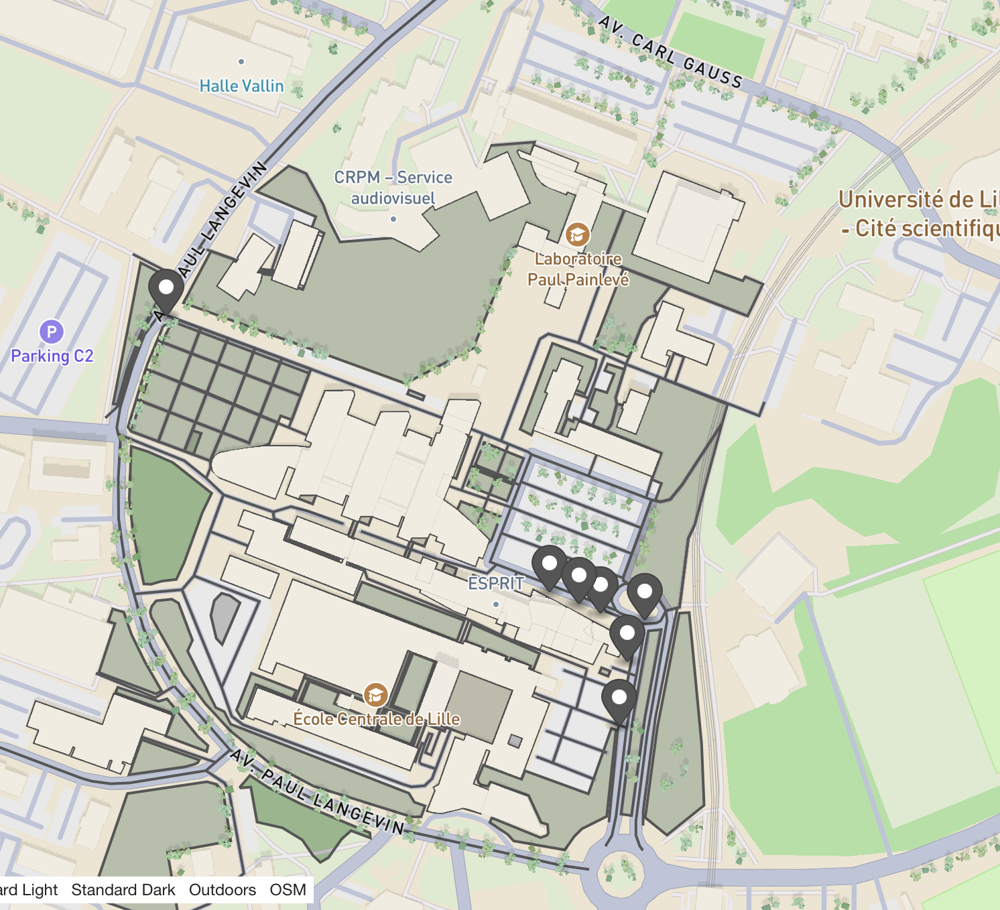
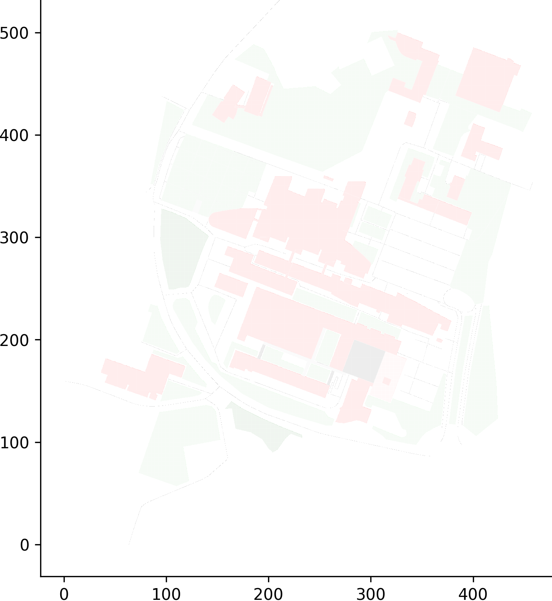
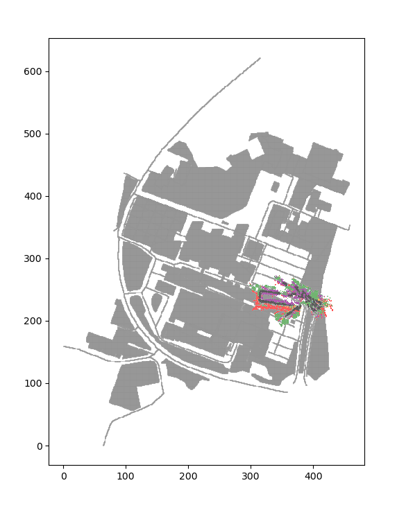
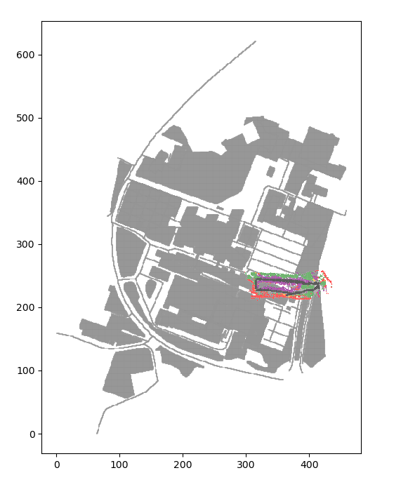
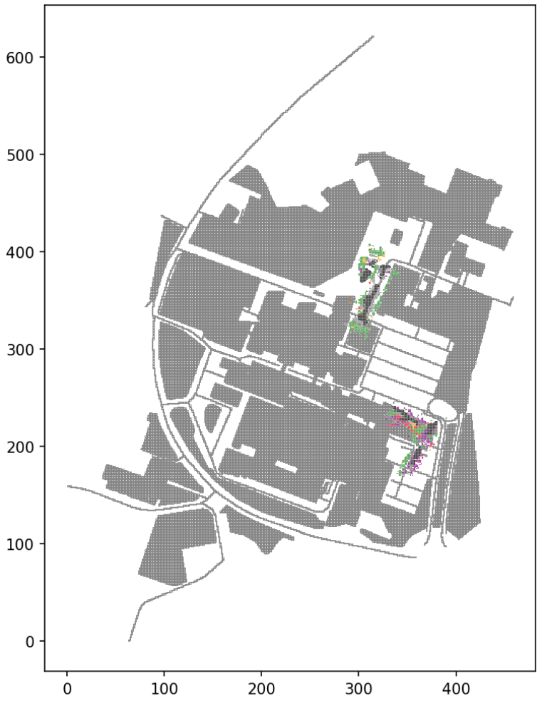

# LOSY - LIO-SAM Semantic YOLO

LOSY construit une carte géométrique et sémantique, mono ou multirobots, à partir d'une caméra 2D, d'un LiDAR 3D et de l'odométrie de LIORF. Chaque scan LiDAR est projeté dans l'image, étiqueté grâce au masque de segmentation YOLO, puis replacé dans le repère monde. Les points sont ensuite discrétisés en grille 2D ou en voxels 3D et exportés en GeoJSON (EPSG:2154).

LIORF reprend l'architecture de LIO-SAM avec une IMU 6 axes, ce qui le rend compatible avec KITTI. Le modèle `yolo26n-sem.pt` (YOLO26 nano sémantique) est entraîné sur Cityscapes : il est adapté aux scènes urbaines et devra être ré-entraîné pour d'autres environnements (forêt par exemple).

Développé par Dan Calamia au laboratoire CRIStAL (projet ANR-SOS), dans le cadre d'un stage de M2 SAR (Sorbonne Université).



## Pipeline commun

```
Image + LiDAR  -> synchronisation (ApproximateTimeSynchronizer, 50 ms max)
               -> projection LiDAR -> image (Tr, P2) + filtres (profondeur, champ de vision, portée)
               -> label YOLO lu au pixel de chaque point (coordonnées LiDAR d'origine conservées,
                  pas de transformation inverse)
               -> pose interpolée sur l'odométrie LIORF (lerp position, slerp rotation)
               -> repère monde
               -> (option) recalcul de tous les points après loop closure
               -> discrétisation 2D / 3D -> GeoJSON + PNG
```

Le paramètre `acquisition_hz` limite la fréquence de traitement : les paires image/LiDAR arrivées trop tôt sont ignorées pour que YOLO ne prenne pas de retard.

## 1. KITTI (sans carte a priori)

| Fichier | Rôle |
|---|---|
| `lidar_camera_fusion_tf.py` | Test : pose récupérée via les TF publiées (`world` -> `velodyne`). |
| `lidar_camera_fusion_odom.py` | Test : pose récupérée par abonnement à l'odométrie (`/liorf/mapping/odometry`). C'est cette solution qui a été retenue, l'approche TF étant plus coûteuse. |
| `projection_kitti.py` | Noeud de référence sur KITTI : odométrie interpolée, loop closure, confiance par distance, export 2D/3D. |

Calibrations KITTI codées en dur. La carte est générée à l'arrêt du noeud (Ctrl+C). Le champ `ring`, absent des données brutes KITTI, doit être recalculé lors de la conversion en bag (`kitti2bag`) pour que LIORF fonctionne.

### Lancer LOSY

```bash
ros2 run losy projection_kitti
```

### Lancer LIORF

```bash
ros2 launch liorf run_kitti.launch.py
```

### Lire le bag KITTI

Le bag se trouve dans `liorf/config/doc/kitti2bag`.

```bash
ros2 bag play kitti_2011_09_26_drive_0036_synced/ --clock --topics \
  /points_raw /imu_raw /imu_correct /gps/fix /gps/vel /gps/fix/correct \
  /kitti/camera_color_left/camera_info /kitti/camera_color_right/camera_info \
  /kitti/camera_color_left/image_raw /kitti/camera_color_right/image_raw
```



## 2. Robots Scout / Ranger avec carte a priori

| Fichier | Rôle |
|---|---|
| `projection_map_apriori.py` | Noeud mono-robot. Paramètre `robot` : `scout` ou `ranger`. |
| `losy.launch.py` | Lance `projection_map_apriori` avec les paramètres de `config/config.yaml` (choix du robot, etc.). |

La carte a priori (`priormap/export_grid.geojson`) représente les alentours du bâtiment ESPRIT. Elle a été extraite d'OpenStreetMap via Overpass Turbo puis discrétisée avec GeoPandas ; quand une cellule recouvre plusieurs zones, un obstacle (`building`) l'emporte sur une zone libre (`road`). Elle peut être remplacée par n'importe quelle grille GeoJSON avec une colonne `label`. Pour l'instant elle sert uniquement de fond de carte et n'est pas fusionnée dans le GeoJSON de sortie.

Les coordonnées sont normalisées par rapport à l'origine de la carte (`xmin_map`, `ymin_map`), puis les points sont tournés et décalés selon la position et l'orientation initiales du robot.

 

### Lancer LOSY

Le robot (`scout` ou `ranger`) se choisit dans `config/config.yaml`.

```bash
ros2 launch losy losy.launch.py
```

ou, sans le launch :

```bash
ros2 run losy projection_map_apriori
```

### Lancer LIORF

```bash
ros2 launch liorf run_ranger.launch.py     # ou run_scout.launch.py
```

### Lire le bag Ranger

Les bags se trouvent dans `multirobots_ws`.

```bash
ros2 bag play bag/ --clock --qos-profile-overrides-path qos_override.yaml
```

### Lire le bag Scout

```bash
ros2 bag play bag_scout/ --clock --qos-profile-overrides-path qos_override.yaml --start-offset 60.0
# ou sans offset 
```
L'offset avait été mis car on a remarqué que l'imu dérivait beaucoup au début du bag. 

Le bag Scout est lancé avec 60 s d'offset : sur le début de l'acquisition, LIORF dérive fortement, probablement parce que les données IMU brutes sont utilisées sans lissage.

Résultat avec le Scout, sans puis avec loop closure :

 

## 3. Multirobots avec carte a priori

| Fichier | Rôle |
|---|---|
| `perception.py` | Un noeud par robot (namespace = nom du robot) : fusion LiDAR/caméra, YOLO, odométrie, loop closure. Ne construit plus de carte, publie ses points. |
| `map_fusion.py` | Un seul noeud : reçoit les points de tous les robots, charge la carte a priori et exporte la carte toutes les `write_interval_sec` secondes (30 s par défaut), puis à l'arrêt. |
| `tf_prefixer.py` | Ajoute le préfixe `<robot>/` aux frames de `/<robot>/tf_raw` et `/<robot>/tf_static_raw` et republie sur `/tf` et `/tf_static`. |
| `losy_multirobots.launch.py` | Lance un `perception` par robot de la liste `ROBOTS` et un seul `map_fusion`. |

Topics publiés par `perception.py` :

- `/<robot>/semantic_points` : `PointCloud2` (`x, y, z, label_id, conf, stamp`) déjà dans le repère final. Les labels sont envoyés sous forme d'identifiant, car un `PointCloud2` n'accepte que des champs numériques.
- `/<robot>/semantic_points_labels` : table `label_id -> nom`, publiée une seule fois (latched).
- `/<robot>/semantic_points_control` : commande `reset` envoyée après une loop closure, avant la republication de tous les points recalculés.

### Namespaces et TF

Tous les topics (LIORF, LOSY, bags via remap) sont placés dans un namespace par robot. Pour l'arbre TF, deux options étaient possibles :

- remapper `/tf` et `/tf_static` en `tf` et `tf_static` pour qu'ils prennent le namespace : chaque robot a son propre arbre, mais aucune relation entre robots n'est possible (pas d'affichage commun dans RViz) ;
- préfixer les frames (`scout/base_link`, `ranger/base_link`) en gardant un seul `/tf` partagé : plus long à mettre en place, car tous les noeuds doivent utiliser les noms préfixés, mais cela permet de relier les robots entre eux.

La seconde option a été retenue, d'où `tf_prefixer.py`.

### Lancer LOSY (perception par robot + map_fusion)

```bash
ros2 launch losy losy_multirobots.launch.py
```

### Lancer LIORF pour tous les robots

```bash
ros2 launch losy liorf_multirobots.launch.py
```

### Lire les bags des deux robots

```bash
ros2 launch losy bag_multirobots.launch.py
```

En conditions réelles, les noeuds `perception` tournent embarqués sur chaque robot et `map_fusion` peut tourner sur une station au sol, tant que le domaine DDS est partagé.



## Paramètres principaux

| Paramètre | Description | Fichiers |
|---|---|---|
| `robot` | `scout` ou `ranger` | apriori, perception |
| `robots` | Liste des robots à fusionner | map_fusion |
| `dim` | `2d` ou `3d` | kitti, apriori, map_fusion |
| `cell_size` / `cell_size_z` | Taille de cellule XY / Z (m) | kitti, apriori, map_fusion |
| `acquisition_hz` | Fréquence de traitement des paires image/LiDAR | noeuds de perception |
| `range` | Portée max retenue (m), sert aussi au calcul de confiance | noeuds de perception |
| `loop` | Active le recalcul après loop closure (à activer aussi dans LIORF) | kitti, apriori, perception |
| `xmin_map`, `ymin_map`, `xmax_map`, `ymax_map` | Emprise de la carte a priori (Lambert 93) | apriori, perception, map_fusion |
| `write_interval_sec` | Période d'export de la carte | map_fusion |
| `prior_map_path`, `output_dir` | Carte a priori et dossier de sortie | map_fusion |

## Ajouter un robot

Dans `perception.py` (et `projection_map_apriori.py` si utilisé), ajouter une branche `elif self.robot == "<nom>":` avec :

- `x_init_robot`, `y_init_robot` : position initiale GPS (Lambert 93), à déclarer en paramètres `xinit_robot_<nom>` / `yinit_robot_<nom>`
- `angle_init_robot` : orientation initiale (rad)
- `P2` : matrice intrinsèque 3x4 de la caméra
- `Tr` : matrice extrinsèque 4x4 LiDAR -> repère optique caméra
- `W`, `H` : résolution de la caméra

Les calibrations KITTI sont déjà fournies. Pour un nouveau robot :

### Calibration intrinsèque (P2, W, H)

```bash
ros2 topic echo /<robot>/camera/color/camera_info
```

### Calibration extrinsèque LiDAR -> caméra (Tr)

```bash
ros2 run tf2_ros tf2_echo camera_color_optical_frame os_lidar
```

Le robot doit publier sur `/<nom>/camera/color/image_raw`, `/<nom>/ouster/points` et `/<nom>/liorf/mapping/odometry`. Ajouter ensuite `<nom>` à `ROBOTS` dans `losy_multirobots.launch.py` et lancer un `tf_prefixer` avec `prefix:=<nom>`.

## Position et orientation initiales

Les modes carte a priori et multirobots ont besoin de la position et de l'orientation initiales de chaque robot pour centrer la carte sémantique sur la carte a priori. Ces valeurs ont été relevées à la main à l'aide d'un script qui récupère les premières positions (voir le dossier `Calibration`).

Cette méthode est peu précise : la position repose sur un seul point GPS (environ 6 m de covariance) et l'orientation issue du magnétomètre de l'IMU n'est pas fiable. Pistes : moyenner plusieurs mesures GPS, et déduire l'orientation en faisant avancer le robot de quelques mètres avant le déploiement.

## Sorties

Avec les launch, les images sont uniquement enregistrées (pas d'affichage) : dans `geojson_folder/` pour le mode carte a priori, dans `multi/` pour le mode multirobots.

- `discretized2D_semantic_map_step_<step>.geojson` / `.png` : centre de chaque cellule, label dominant, `pct_dominant`
- `discretized3D_semantic_map_stepXY_<step>_stepZ_<stepz>.geojson` / `.png` : par voxel, label dominant, `nb_total`, `pct_dominant`, `tmin`, `tmax`, `conf_range`, `trav`
- `path/corrected_path.png` : trajectoire brute vs corrigée (loop closure, mode mono-robot)

## Limites et pistes

- Les points ne sont recalculés qu'après une loop closure. Quand LIORF corrige sa trajectoire par simple scan matching, LOSY ne suit pas cette mise à jour (reste à vérifier si LIORF corrige tout l'historique ou seulement la dernière pose).
- Le recalcul après loop closure est coûteux et grossit avec la durée de la mission : à haute vitesse ou en multirobots sur une seule machine, des frames sont perdues.
- En multirobots, une cellule vue par deux robots apparaît en double dans le GeoJSON. Une fusion bayésienne est prévue pour remplacer le label dominant.
- La traversabilité (`dict_trav`) n'est renseignée que pour `road`.
- Les chemins de sortie sont absolus (`/home/multirobots/multirobots_ws/src/losy/...`) et doivent être adaptés.